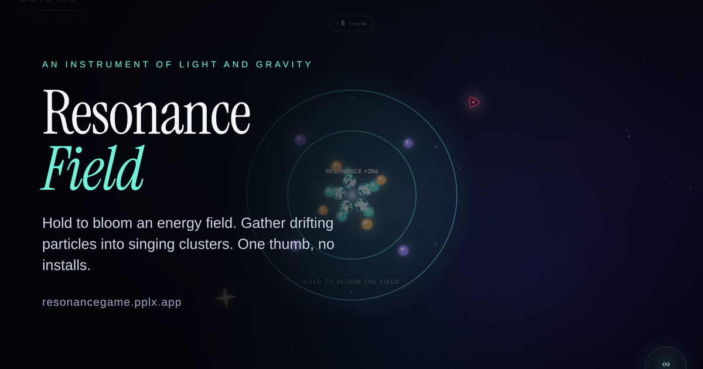
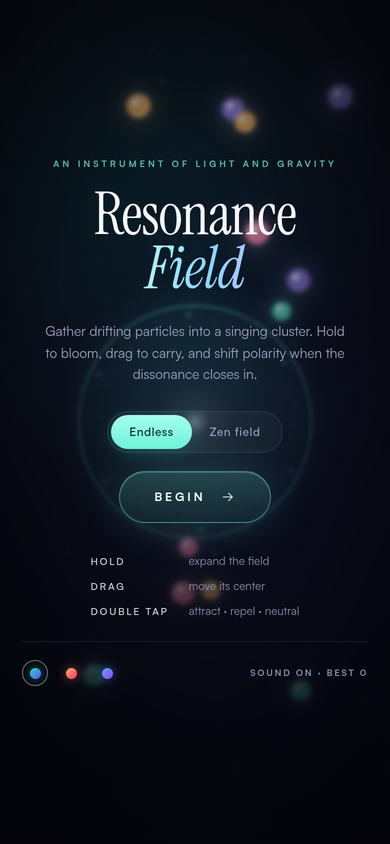
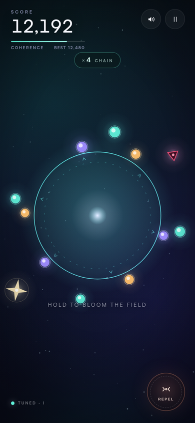
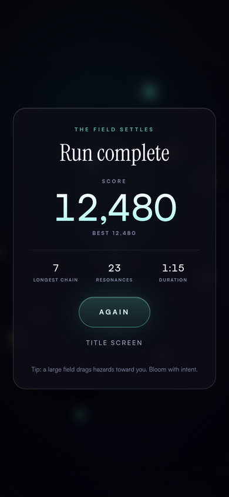
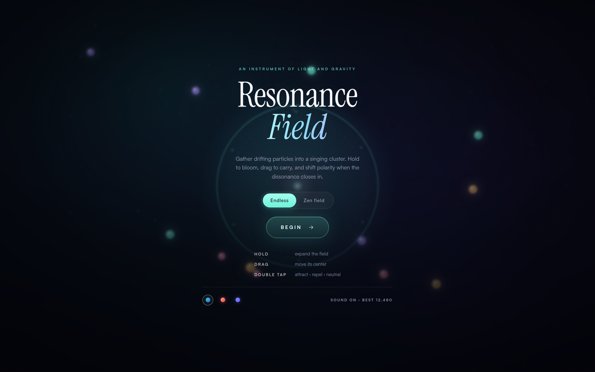

# Resonance Field

**An instrument of light and gravity.** A one-thumb, physics-driven browser game: hold to
expand a living energy field, release to contract, drag to carry it, and shift polarity to
gather drifting particles into singing clusters. Runs offline as an installable PWA.
No accounts, no ads, no build step.

- **Play now:** [resonancegame.pplx.app](https://resonancegame.pplx.app) — no install, works offline
- **Run the source:** open `index.html` through any static server (see below)
- **Size:** ~85 KB of HTML/CSS/JS (no framework, no audio files, two web fonts)
- **Target:** modern mobile browsers first (iOS Safari 16+, Chrome Android), desktop second
- **Licence:** MIT


<p align="center">
  
</p>

<p align="center">
  
  
  
  
</p>

<p align="center"><em>Left to right: title, a live run at 12,192 with a x4 chain, the closing card, and the desktop title. All captured from the build in this repository.</em></p>

---

## Run it locally

Any static file server works. From this folder:

```bash
npx serve .            # then open the printed http://localhost:3000
# or
python3 -m http.server 3000
```

Then visit `http://localhost:3000`. Opening `index.html` directly from the filesystem
(`file://`) works for a quick look, but the service worker and the manifest require
`http://` or `https://`, so offline install only works when the game is served.

### Install as an app

Serve over HTTPS (or `localhost`), open it, then:

- **iOS Safari:** Share → Add to Home Screen
- **Chrome / Edge Android:** menu → Install app / Add to Home screen

Once installed it launches full-screen and plays with no network connection.

### Deploy

**Live site: [resonancegame.pplx.app](https://resonancegame.pplx.app)**

The live page is served from `dist/`, a bundle generated from a commit and never edited by
hand:

```bash
./tools/build-dist.sh   # assembles dist/ and writes dist/version.json
```

`dist/version.json` records the full commit SHA, the branch and the build time, and the title
screen prints the short SHA as a build stamp. Publishing `dist/` unchanged is what keeps the
live site identical to `master`.

Two checks guard the link between the repository and the live page:

- **Verify** runs on every push and pull request: syntax check, a check that the bundle is
  stamped with that exact commit and built from a clean tree, then a headless smoke test of
  the player flows in `tests/smoke.mjs`.
- **Live matches master** runs each morning and on demand: it reads the live
  `/version.json`, compares the commit with `master`, then compares SHA-256 hashes of
  `index.html`, `css/style.css`, `js/game.js`, `js/audio.js`, `js/build-stamp.js` and `sw.js`.
  It opens or updates an issue when the live site falls behind.

To publish an update: run `./tools/build-dist.sh`, deploy the `dist/` folder, then check that
the build stamp on the title screen matches `git rev-parse --short HEAD`.

Any static host works for a copy of the site — Netlify, Vercel, Cloudflare Pages, GitHub
Pages or a plain web server. The only requirement is HTTPS for the PWA parts, and
`index.html` has to sit at the site root so `./sw.js` and `./manifest.webmanifest` resolve.

---

## Controls

| Action | Touch | Mouse | Keyboard |
| --- | --- | --- | --- |
| Expand / strengthen the field | press and hold | press and hold | — |
| Contract | release | release | — |
| Move the field | drag | move with button held | — |
| Cycle field mode (attract → repel → neutral) | double tap, or the mode button | double click / mode button | `m` |
| Pause | pause button (top right) | same | `p` or `Esc` |
| Resume | tap resume | click | `p`, `Esc` or `Enter` |
| Restart after a run | large **Again** button | same | `Enter` |
| Mute | speaker button | same | — |

No keyboard is required for play; the key bindings are a desktop convenience.

## How to play

Everything orbits one idea: **resonance pays, dissonance drains**.

- **Harmonics** (four colours = four frequencies) sing when two or more of the *same*
  frequency sit close together inside your field. Hold them there and a bloom fires: score
  scales with how many objects joined and how long you sustained it, and each bloom in a
  quick chain multiplies the next.
- **Neutrals** are convertible — they resonate with anything and build charge 45% faster.
  Treat them as glue.
- **Dissonants** are the wrong note. They resist attraction, and drain coherence when they
  crowd your core. They are never gathered: Attract nudges them away weakly, **Repel** shoves
  them clear.
- **Core Echoes** are rare bright motes. Sweep the field through one for a big multiplier
  and a chunk of coherence back.
- **Hazards** (spikes, wells) are pulled toward a large field. Keep the field small near
  them; the deeper the field is expanded, the harder they home in. **Repel** pushes them back
  out, slowly — they are heavy, so start early.
- **Coherence** is your life. It drains slowly, faster over time, and much faster when
  dissonants or hazards sit in your core. Blooms give some back.

The run usually ends with *almost* rather than *sudden*: coherence fades, the screen dims,
and the field settles.

### Modes

- **Endless Resonance** — the main mode, escalating pressure, one high score.
- **Zen Field** — same physics, coherence never drains, no failures. For practice and for
  playing with the instrument. A Zen session has no ending of its own: pause and choose
  **End session** when you are done, and the score card records it as a Zen best.
- **Daily Pulse** and **Resonance Trials** are designed in the GDD but not in this build
  (see [Roadmap](#roadmap)).

### Scoring

| Source | Points |
| --- | --- |
| Resonance bloom | `26 × group size × chain multiplier` (multiplier caps at 5) |
| Core Echo | `180 × chain multiplier` |
| Style / near-miss bonuses | small, awarded on tight sweeps |

Chain multiplier grows by 0.3 per consecutive bloom and resets after 3.4 s without one
(the 1.7 s figure is the per-entity cooldown before it can bloom again).
Progression is cosmetic only: field themes (Aurora, Ember, Abyss) are chosen on the title
screen and remembered locally.

---

## Architecture

```
resonance-field/
├── index.html            # markup, HUD, screens, SVG iconography
├── css/style.css         # design tokens, glass panels, responsive rules
├── js/audio.js           # RF.Audio — generative Web Audio engine
├── js/game.js            # engine: state, input, physics, resonance, render, loop
├── sw.js                 # service worker (network-first, cache fallback)
├── manifest.webmanifest  # PWA manifest
├── icons/                # app icons (PNG any/maskable + SVG)
├── media/                # screenshots and the link-preview card
└── README.md, LICENSE, CONTRIBUTING.md, progress.md
```

`js/game.js` is one IIFE split into numbered sections (utilities, configuration, canvas and
sprites, state, DOM, input, entities, simulation, rendering, loop). Key ideas:

- **Fixed-ish timestep.** The loop accumulates real time and steps the simulation at
  1/60 s, so physics behaves the same on 60 Hz and 120 Hz screens.
- **Field as a force, not a container.** Each entity feels `attract` or `repel` force
  scaled by `(r / maxR)²`, so expanding changes the *character* of the field, not just its
  size. Dissonants invert the sign; neutrals feel no force but resonate faster.
- **Resonance as a graph problem.** Every frame, entities of the same frequency that are
  both inside the field and within reach of each other are linked. Charge accrues at
  `links × 0.52` per second; at 1.0 the connected group fires as one bloom.
- **Cached rendering layers.** Starfield, background gradient and the nebula are baked into
  offscreen canvases (nebula at half resolution) and only rebuilt on resize or theme change.
  Glow sprites are pre-rendered, so the per-frame cost is draw calls and cheap alpha, not
  blur filters.
- **Object pools.** Particles, floating score text and ripples are pooled; gameplay never
  allocates in the hot loop.

### Tuning constants

All gameplay numbers live in the configuration section of `js/game.js` (search for the
block marked `2. Configuration`) plus the local constants in each simulation function.
The ones you will most likely want to touch:

| Constant | Where | Meaning |
| --- | --- | --- |
| `FREQS` | config | The four frequencies: name, colour, audio root |
| `THEMES` | config | Background nebulae and star tint per theme |
| `MAX_ENTITIES` / `MAX_PARTICLES` | config | Hard caps for object pools |
| `baseR`, `maxR` | `resize()` | Field radius at rest and fully bloomed |
| `hold` ramp (0.55 s / 0.28 s) | input | How fast the field blooms and collapses |
| base `drain` in `updateCoherence()` | simulation | Coherence loss per second, 1.05 rising to 2.3 |
| hazard / dissonant / crowding terms | `updateCoherence()` | 17/s per hazard (diminishing, capped at 30), 6/s per dissonant (capped at 18), +0.35/s beyond 38 entities |
| `26 × group × mult` | `fireResonance()` | Bloom scoring |
| `0.52` link rate, `1.7 s` cooldown | resonance | Chain pacing |

### Audio

`js/audio.js` synthesises everything at runtime — no samples. A six-voice detuned pad sits
under a filtered noise "air" layer, feeding a generated convolution reverb and a limiter.
Bloom tones are drawn from a minor pentatonic scale whose root shifts per frequency, so
clusters of different colours form consonant chords by construction. A slow arpeggio and
sparse bells sit in the 400–1300 Hz octave; the pad filter opens as your score climbs. The
`AudioContext` is created on the first user gesture, so nothing plays before a tap.

The mix is voiced deliberately high: a phone speaker rolls off sharply below roughly 400 Hz,
so a bass-heavy ambient bed reads as "no sound at all" on the device most players use. The
pad's weight sits at 220–660 Hz, the sub voices are trimmed, and the high-passed level
(RMS ≈ 0.08 at 400 Hz) is what to check if you retune it — not the raw output level, which
is dominated by low frequencies you cannot hear on a phone.

### Storage

Best score, Zen best and the selected theme are stored in **one small cookie** (`rf_v1`,
one year, `SameSite=Lax`) by the `Save` adapter at the top of `js/game.js`. If cookies are
blocked — sandboxed iframes, some private modes — the adapter silently falls back to
in-memory values for the session, and the game plays identically without persistence.
Nothing else is stored, nothing is sent anywhere, and there are no third-party scripts.

> The GDD specifies `localStorage`. Cookies are used instead so the game also persists in
> embedded/preview contexts that block `localStorage`; swap the two `Save` methods for
> `localStorage.getItem/setItem` if you prefer the original design.

### Offline / PWA

`sw.js` is network-first with a cache fallback: online you always get the freshest build,
offline you get the cached shell. It precaches the HTML, CSS, JS, manifest and icons on
install; fonts are cached the first time they are fetched. Bump the `CACHE` name when you
ship a breaking change to force a clean slate.

---

## Accessibility & performance notes

- Leaving the tab, locking the phone or taking a call auto-pauses the run instead of draining it.
- Optional haptics: a light tap on a bloom, a firmer buzz on a hazard hit, a three-beat pulse when
  the run ends. Silently skipped on devices without vibration.
- All tap targets are at least 44 px; the mode button and pause button sit in thumb reach.
- HUD text is `aria-live="off"` for scores and the queue is throttled, so screen readers
  are not spammed during play.
- Colour is never the only signal: frequencies also differ in edge style and audio pitch.
- `prefers-reduced-motion` dampens shake, flash and particle counts.
- The viewport is zoomable: pinching the title and cards is not blocked (the play canvas
  keeps `touch-action: none` so drags still steer the field).
- The title-screen sound control is a real button, reachable by keyboard and screen reader.
- Geometry uses device-pixel-ratio capped at 2, so 3× phones render at 2× rather than
  paying 9× fill cost.
- Layout verified without overflow at 320×568, 375×667, 390×844, 844×390 and 1440×900.

## Testing

The build exposes a small harness for automated checks:

```js
render_game_to_text()   // JSON snapshot: phase, score, coherence, field, entities
advanceTime(ms)         // step the simulation deterministically
__rf.start('endless')   // start a run
__rf.setMode('repel')   // change mode
__rf.spawn('harmonic', 0, x, y)
__rf.setCoherence(100)  // 0–100 scale
__rf.persist(); __rf.save.read()
```

These hooks are inert for players and useful for Playwright scripts. If you fork this for a
commercial build, strip them.

## Roadmap

From the GDD's nice-to-have list, still open:

- Daily Pulse (seeded 60–90 s run with a shareable result)
- Resonance Trials (hand-authored levels with objectives)
- Shareable score cards (canvas → PNG → Web Share API)
- Unlockable instruments and particle sets (themes exist; unlock flow does not)
- Save export/import as a short code

## Contributing

See [CONTRIBUTING.md](CONTRIBUTING.md). Bug reports and small, focused pull requests are
welcome; keep the zero-dependency, no-build constraint.

## Licence

MIT — see [LICENSE](LICENSE). The two web fonts (Instrument Serif, Satoshi) load from
Google Fonts and Fontshare and keep their own licences; the game falls back to system serif
and sans if they are unavailable.
